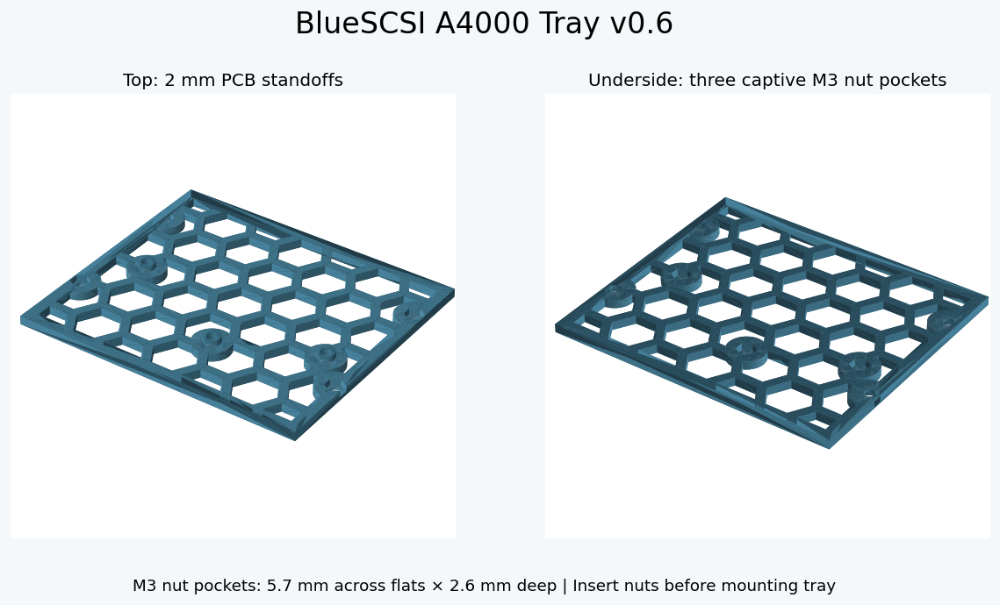

# BlueSCSI A4000 Tray

A mounting tray for the **BlueSCSI 50-pin PCB, revision 2023.10a**, intended for the **Amiga 4000D replica case from [RetroZen](https://retrozen.pl/)**.

## Files

- [Printable tray v0.6 STL](BlueSCSI-A4000-tray-v0.6.stl)
- [Editable OpenSCAD source](BlueSCSI-A4000-tray.scad)

## Revision 0.6

Replaces the three round underside PCB screw-head counterbores with captive M3 hexagonal nut pockets, 5.7 mm across flats and 2.6 mm deep. Insert nuts from underneath before mounting the tray; fit the PCB screws from above. The case floor retains the nuts once installed directly against it. Loose nuts can fall out before installation.

Uses a regular staggered honeycomb pattern with larger hexagonal through-cut-outs and partial cells at the perimeter. The mounting geometry is retained:
- Base: 101.6 × 89.2046 × 3 mm.
- Three PCB standoffs: 2 mm above the base.
- PCB underside: 5 mm above the case floor when mounted directly.
- Four case fixing positions: 95.25 mm across and 44.45 mm between rows.
- Existing M3 clearance holes, case nut pockets and underside PCB hexagonal nut pockets.
- Corrected PCB mounting handedness from v0.3; intended SD access towards the side of the case with the lid removed.

Full hexagons are 16 mm point-to-point, with uniform 3 mm webs between adjacent cells. Partial cells follow a 4 mm solid perimeter. Each fixing retains a solid 6.5 mm-radius pad, excluding its existing screw/nut recess.

## Printing and fitting

Print flat underside down, in millimetres at 100% scale. Suggested starting settings: 0.2 mm layers and four walls. Inspect the slicer around the nut-pocket roofs and check nut fit before assembly.

Use suitable M3 hardware and check screw engagement. Screw tips must not protrude below the tray and foul the case. The pockets leave 2.4 mm of material to the top of each standoff along the screw axis. The low standoffs leave only 2 mm between PCB underside and tray top: check all pins and solder joints before tightening. The cut-outs are not a substitute for clearance checks, and expose areas of the board underside to the metal case beneath.

The source retains optional 18 mm spacers via `part="spacers"`; they are not needed for the low-profile direct mounting arrangement.

## Validation

The exported v0.6 STL is a single closed solid with overall height 5 mm. All mounting coordinates are unchanged from v0.3. The v0.6 nut-pocket revision has not yet been physically print-tested. Verify case and PCB fit before final assembly.
