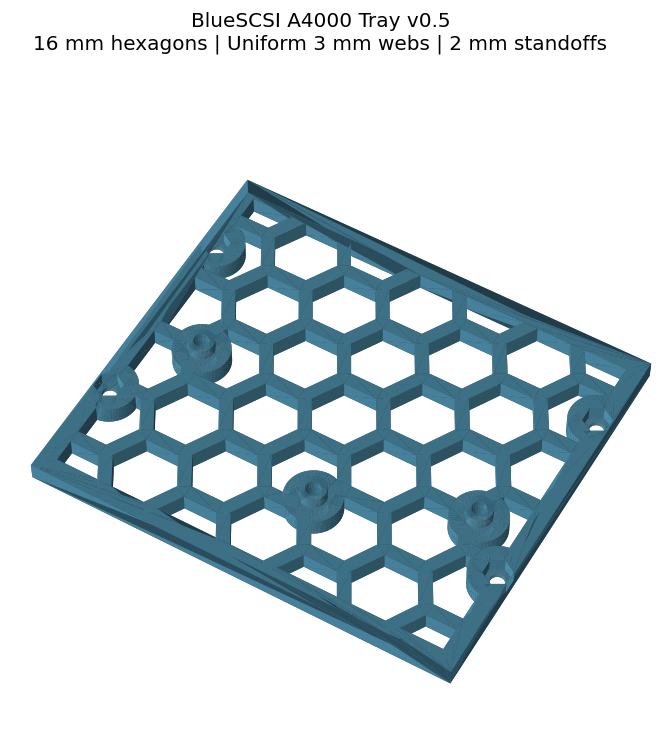

# BlueSCSI A4000 Tray

A mounting tray for the **BlueSCSI 50-pin PCB, revision 2023.10a**, intended for the **Amiga 4000D replica case from [RetroZen](https://retrozen.pl/)**.

## Files

- [Printable tray v0.5 STL](BlueSCSI-A4000-tray-v0.5.stl)
- [Editable OpenSCAD source](BlueSCSI-A4000-tray.scad)

## Revision 0.5

Uses a regular staggered honeycomb pattern with larger hexagonal through-cut-outs and partial cells at the perimeter. The mounting geometry is retained:
- Base: 101.6 × 89.2046 × 3 mm.
- Three PCB standoffs: 2 mm above the base.
- PCB underside: 5 mm above the case floor when mounted directly.
- Four case fixing positions: 95.25 mm across and 44.45 mm between rows.
- Existing M3 clearance holes, case nut pockets and underside PCB screw counterbores.
- Corrected PCB mounting handedness from v0.3; intended SD access towards the side of the case with the lid removed.

Full hexagons are 16 mm point-to-point, with uniform 3 mm webs between adjacent cells. Partial cells follow a 4 mm solid perimeter. Each fixing retains a solid 6.5 mm-radius pad, excluding its existing screw/nut recess.

## Printing and fitting

Print flat underside down, in millimetres at 100% scale. Suggested starting settings: 0.2 mm layers and four walls. Inspect the slicer around underside counterbores.

Use suitable M3 hardware and check screw engagement. The low standoffs leave only 2 mm between PCB underside and tray top: check all pins and solder joints before tightening. The cut-outs are not a substitute for clearance checks, and expose areas of the board underside to the metal case beneath.

The source retains optional 18 mm spacers via `part="spacers"`; they are not needed for the low-profile direct mounting arrangement.

## Validation

The exported v0.5 STL is a single closed solid with overall height 5 mm. All mounting coordinates are unchanged from v0.3. The revised cut-out tray has not yet been physically print-tested or load-tested. Verify case and PCB fit before final assembly.
