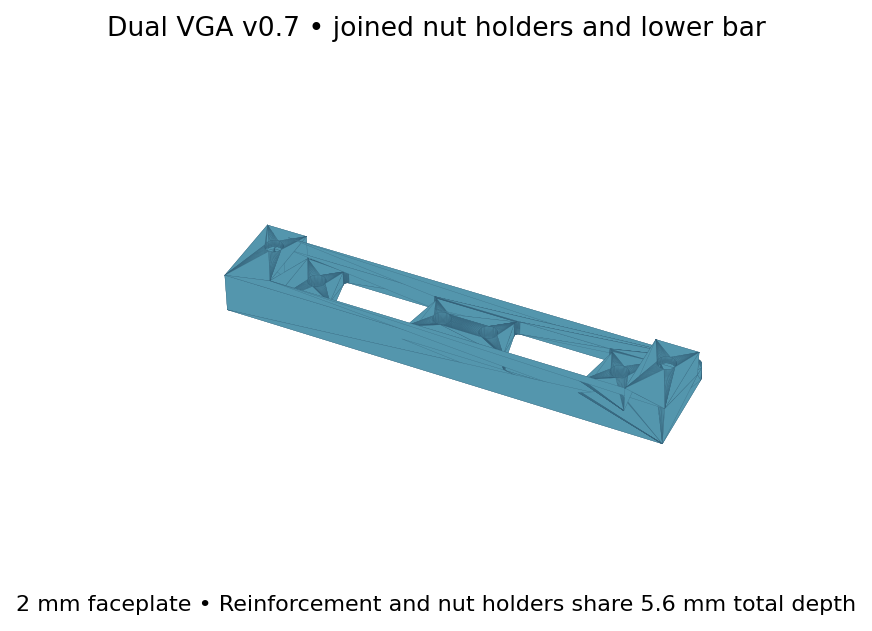

# Amiga 4000D Ratte Auto Monitor Switch Bracket

Dual-VGA mounting bracket intended for the Ratte Auto Monitor Switch installation in the **Amiga 4000D replica case from [RetroZen](https://retrozen.pl/)**.

This is the latest **v0.7 reinforced top-slot version**, with a 2 mm faceplate and a full-width lower reinforcement joined to both nut holders.

## Files

- [Printable STL](Dual-VGA-top-slot.stl)
- [Editable OpenSCAD model](Dual-VGA-top-slot.scad)

## Dimensions

| Feature | Dimension |
|---|---|
| Overall width × height × depth | 84 × 20 × 5.6 mm |
| Main faceplate thickness | 2 mm |
| Case opening | 68 × 14 mm |
| Case mounting centres | 76 mm |
| VGA connector centres | 34 mm |
| Each VGA connector fixing pitch | 24.99 mm |
| Rounded D openings, underlying trapezoid | 19 mm top × 15 mm bottom × 10 mm high |
| Cut-out corner radius | 0.75 mm |
| M3 nut clearance | 5.7 mm across flats × 2.6 mm deep |
| Rear nut-retaining wall | 1 mm |

The full-width lower bar extends 2 mm below the original faceplate and has a total depth of 5.6 mm. Both end nut holders connect to this bar for strength.

## Hardware and assembly

Use two ordinary M3 hex nuts and suitably sized M3 bolts for the case mounting points. The nut slots are not sized for taller Nyloc nuts.

Insert the nuts down through the top entrances until their centres align with the case bolt holes. Integral rear walls retain the nuts from behind; no separate covers or glue are required. Keep the bracket upright until the bolts engage, as loose nuts can slide back out through the top.

Use connector-matched fixings for the VGA sockets. These are often 4-40, not M3; the printed holes provide clearance only. Check screw lengths and connector engagement with the 2 mm faceplate.

## Printing

Print flat as supplied, faceplate against the bed and nut holders upwards. Import in millimetres at 100% scale. Suggested starting settings: 0.2 mm layers and solid infill.

The rear walls bridge the nut channels. Inspect bridging in the slicer and avoid difficult-to-remove supports inside the nut slots. Clear any sag before inserting nuts. Tighten gently.

Check clearance for the additional 2 mm below the bracket and the 5.6 mm total depth.

## Revision and validation

V0.7 is the latest reinforced design. The earlier 1 mm plate was reported too weak; this version uses the thicker plate and connected lower reinforcement.

The recovered archive records a closed-manifold STL check. Physical fit and bridge quality of this reinforced version should be checked with a test print.

Nut clearance follows the [DB23 connector project](https://github.com/HoodPaul/amiga-db23-alternative/blob/main/source/design_parameters.json).
