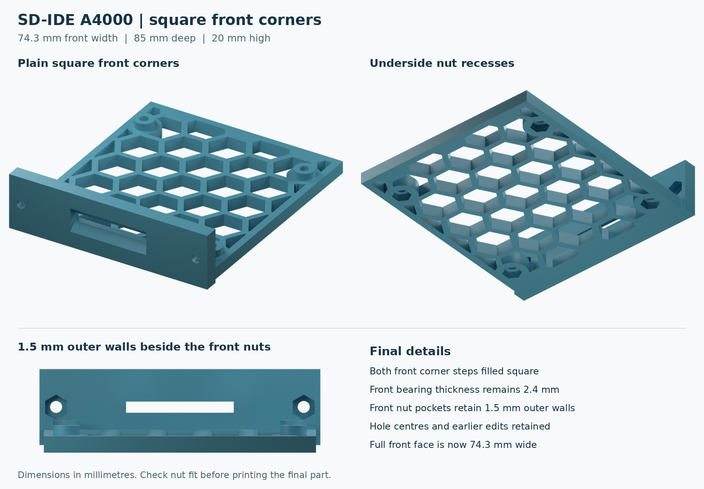

# Amiga A4000 SD35VC0 Expansion Bay Bracket

A 3D-printable expansion bay bracket for mounting an **SD35VC0 SD-to-IDE adaptor** in an **Amiga A4000**.

The bracket provides an accessible SD card opening, four PCB support pillars and recessed M3 nut pockets beneath the base and behind the front face.

**Adaptor:** [SD35VC0 product listing](https://www.aliexpress.com/item/1005012270492071.html). Check that the board layout and mounting holes match before printing.

## Files

| File | Description |
| --- | --- |
| [SD-IDE-A4000.3mf](SD-IDE-A4000.3mf) | Bracket model in 3MF format, with millimetre units |
| [SD-IDE-A4000.stl](SD-IDE-A4000.stl) | Bracket mesh for slicing; import in millimetres |
| [SD-IDE-A4000-Preview.png](SD-IDE-A4000-Preview.png) | Front, underside and nut-pocket views |

The 3MF contains model geometry, without a printer-specific slicing profile.

## Design details

- Plain, square front corners and a flush front face.
- Reinforced front nut pockets with 1.5 mm outer walls.
- Four PCB support pillars.
- Four recessed M3 nut pockets beneath the base and two behind the front face.
- Honeycomb base with full and partial hexagonal openings to reduce material use.

| Dimension | Value |
| --- | --- |
| Overall width | 74.3 mm |
| Overall depth | 85 mm |
| Overall height | 20 mm |
| Front mounting-hole spacing | 65.5 mm centre to centre |
| M3 clearance-hole diameter | 3.2 mm |
| Nut-pocket size | 5.8 mm across flats × 2.6 mm deep |
| Plastic in front of the front nuts | 2.4 mm |
| Outer wall beside each front nut | 1.5 mm |

## Hardware and fitting

- Up to **6 × M3 hex nuts**, one per fixing point.
- **4 × M3 screws** for the adaptor board and **2 × M3 screws** for the front mounting points. Select lengths to suit the PCB, case and nut engagement.

1. Import the model in millimetres at **100% scale**.
2. Check the 74.3 mm front width, case mounting-hole spacing and adaptor-board hole positions.
3. Use the flat underside as the starting print orientation and inspect the slicer preview around the recessed nut pockets.
4. Test the nut fit before fitting the board. Clear any printing residue without forcing the nuts into place.
5. Fit the board and bracket, then tighten the screws gently. Check that screws do not foul the board or nearby components.

## Validation status

The final square-corner model has passed digital geometry checks. The STL is a closed mesh, and both model formats contain the same bracket geometry.

**Physical print and installed fit are not yet confirmed.**
