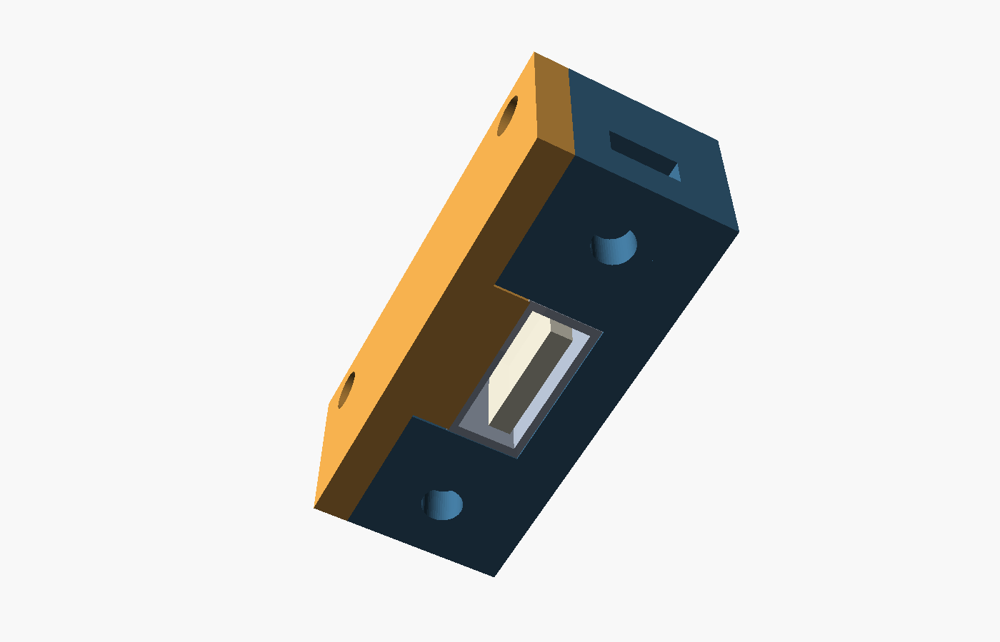

# Single USB-A Mount | Amiga 4000D Replica Case

A two-part 3D-printed compression clamp for fitting a **single USB-A female socket** into the rear panel of the **Amiga 4000D replica case** from [RetroZen](https://retrozen.pl/).

Designed specifically around the **AMST-AF-BK USB-A female cable tail** ([AliExpress listing](https://www.aliexpress.com/item/1005009862187964.html)). The cable is clamped by its metal USB socket, rather than the larger moulded housing.

**Final revision: V0.5.** Physically fit-tested and confirmed working with **four M3 × 8 mm bolts**.

## Download / source files

| File | Description |
| --- | --- |
| [Cradle STL](stl/USB_A_28mm_cradle_print_v05.stl) | Main printable cradle with close-fitting USB channel and captive nut holders |
| [Lid STL](stl/USB_A_28mm_lid_print_v05.stl) | Printable compression lid with integral pressing tongue |
| [OpenSCAD source](source/USB_A_28mm_bracket_v05.scad) | Editable parametric source for both parts |

Only the **two STL parts** are required for a finished mount. The OpenSCAD source is provided for adjustment or re-export.

## Dimensions

| Feature | Measurement |
| --- | --- |
| USB metal socket | 13.84 × 6.26 × 14.00 mm |
| Cradle channel width | 13.94 mm (0.10 mm total clearance) |
| Nominal lid compression | 0.08 mm |
| Case fixing-hole spacing | **28.00 mm** centre-to-centre |
| Existing rear-panel opening | 20.33 × 13.26 mm |
| Printed bracket envelope | 38.40 × 16.60 × 14.00 mm |

The USB socket is held along its 14 mm metal shell. The black moulded cable body remains outside the rear of the clamp.

## Required hardware

- **4 × M3 × 8 mm bolts**: two for the case, two for the compression lid
- **4 × standard M3 hex nuts**: fitted into the captive nut holders
- **1 × AMST-AF-BK USB-A female cable tail**

## Printing

Print the cradle and lid STLs at **100% scale in millimetres**, using their supplied bed orientations. Suggested settings are **PETG**, **0.2 mm layer height**, **4–5 walls** and **35–40% infill**. Check the captive nut pockets for stringing or bridge sag before assembly.

## Assembly

1. Fit two M3 nuts into the cradle's **side-loading** pockets for the case screws.
2. Position the cable's **metal USB socket** in the close-fitting 14 mm cradle channel, facing out through the case opening.
3. Insert two more M3 nuts into the **rear-loading** pockets for the lid.
4. Fit the printed lid and evenly tighten two M3 × 8 mm bolts until the socket is held firmly.
5. Attach the completed mount behind the case using the two remaining M3 × 8 mm bolts at the 28 mm centres.
6. Check that a USB plug engages fully and that the socket cannot slide backwards or pull forwards.

**Do not overtighten.** Excessive compression may distort the metal USB shell and affect the connection. If adapting the design for a different cable, adjust the `usb_width`, `usb_height`, `usb_length`, `width_clearance_total` and `lid_preload` variables in OpenSCAD.

## Compatibility

- Case: [RetroZen Amiga 4000D replica case](https://retrozen.pl/)
- Cable: **AMST-AF-BK** ([AliExpress](https://www.aliexpress.com/item/1005009862187964.html))
- Tested build: **V0.5**, 4 × M3 × 8 mm fasteners and captive nuts

This is a mounting accessory for the above combination. Fit with alternative cases or USB tails is not guaranteed.
